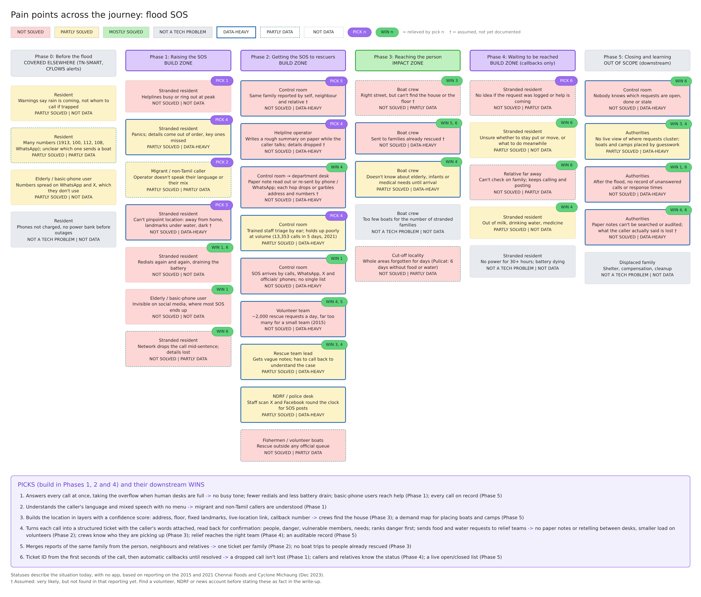
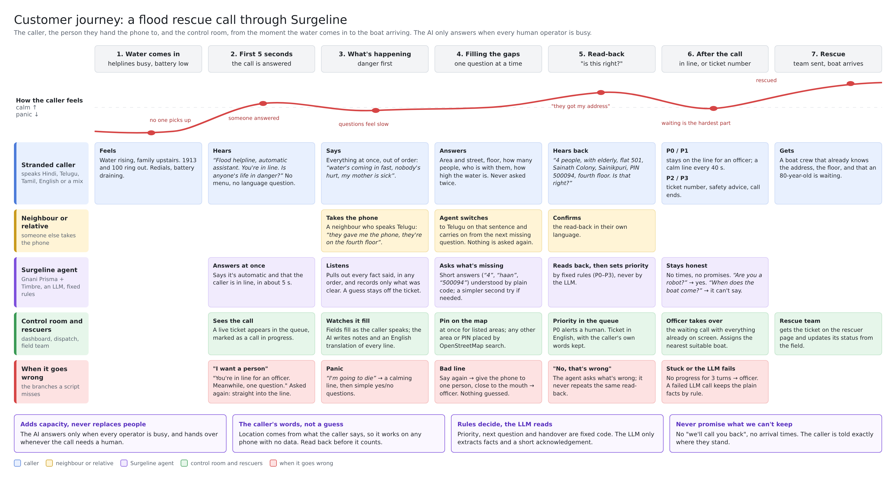

# Surgeline

**When every line is busy, Surgeline picks up.**

A phone line that answers flood rescue calls when every human operator is busy. It talks to
the caller in their own language, collects what rescuers need (where they are, how many
people, who is vulnerable, how high the water is), reads it back for confirmation and turns
the call into a prioritised rescue ticket. A control-room dashboard shows the ticket live, and
an operator sends a rescue team.

Built as a solo entry for Gnani AI's Great Indian AI Internship Challenge.
It is a **prototype tested on synthetic and test calls**, not a deployed service.

---

## The problem

In major floods, the channels people use to ask for help fail at the moment they're needed most:

- **Helplines can't take enough calls at once.** In a surge, callers can't get through, and
  requests go unanswered.
- **Requests move to social media**, where they are scattered, duplicated and hard to act on.
  Volunteer teams have had to handle up to 2,000 requests a day.
- **Details get lost between people.** A request passes from the caller to an operator to a
  control room to a rescue team, and each handover can drop or change details.
- **Callers don't all speak the operator's language**, and many mix languages
  ("hum second floor par hain, water knee tak hai").

Surgeline is meant to **add capacity next to human operators**, not replace them: the AI
takes calls only when no person is free, and hands over to a human whenever the call needs one.

### Evidence: when the lines couldn't keep up

Five floods in three states, from news reports and official statements at the time:

| Flood | What happened to the calls | Source |
|---|---|---|
| **Chennai, Dec 2015** | Volunteers running a rescue-request website got almost 2,000 rescue requests a day and said it was impossible to handle the load with a small team. Over 1.4 million tweets were posted in four days as people turned to social media. | [Twitter blog, 2015](https://blog.twitter.com/2015/guest-post-online-activism-for-chennairainshelp-on-twitter) |
| **Kerala, Aug 2018** | The Chief Minister's office said helplines were getting many requests for people who had already been rescued, and asked callers to give their exact location and nearby landmarks. Rescue alerts were scattered across social media, so many went unnoticed. | [Scroll](https://scroll.in/latest/890979/kerala-floods-imd-limits-alert-to-only-three-districts-as-rain-is-expected-to-subside-from-sunday), [Arab News](https://www.arabnews.com/node/1358311), [The Caravan](https://caravanmagazine.in/vantage/how-social-media-was-vital-to-rescue-efforts-during-the-kerala-floods) |
| **Hyderabad, Oct 2020** | A man trying to get a boat for his elderly in-laws called the helpline numbers and local representatives; no boat was available nearby. | [The News Minute](https://www.thenewsminute.com/amp/story/telangana/hyderabad-floods-ghmc-does-not-have-enough-boats-rescue-allege-residents-135693) |
| **Chennai, Nov 2021** | The state emergency control room took 13,353 calls in five days. The city corporation went from 8 phone lines to 30, then 45, because, as an official put it, people panic when they can't get through. The corporation said it had dealt with 5,500 of its 13,450 complaints by then. | [The News Minute](https://www.thenewsminute.com/article/chennai-rains-how-control-rooms-attend-rain-related-complaints-allay-public-fear-157511) |
| **Chennai, Dec 2023 (Cyclone Michaung)** | Residents who called the corporation's toll-free, WhatsApp and landline numbers said no one answered or the lines stayed busy. Volunteers told people to stop sharing the official numbers because none were reachable, and most residents in low-lying areas were rescued by volunteers. | [The News Minute](https://www.thenewsminute.com/tamil-nadu/chennai-floods-helplines-inundated-people-struggle-to-contact-authorities), [DT Next](https://www.dtnext.in/news/city/calls-to-govt-helplines-go-unanswered-754073) |

The same four failures repeat: **not enough lines** at the peak, **requests moving to social
media** where they get lost, **the same family reported again and again**, and **locations too
vague to act on**. Surgeline takes on the first, second and fourth directly (it answers the
overflow, puts every call into one queue, and builds and reads back the location). Spotting
repeat reports is designed but not built yet.

### Pain points across the journey

Where things break today, phase by phase, and which part of Surgeline relieves each one
(PICK = what we build, WIN = what it fixes further down the line):



### Customer journey

One call from the moment the water comes in to the boat arriving: what the stranded caller
feels and hears, the neighbour who takes the phone, what the agent does, what the control room
and rescuers see, and how the call recovers when things go wrong.



---

## How a call works

```
caller speaks ──► speech-to-text (Gnani Prisma) ──► transcript
                                                    │
         short answer ("4", "haan", "600042")  ◄────┤────► longer sentence
         understood by plain code, no LLM            │     one LLM call extracts the facts
                                                    │     and says which language the words are in
                                                    ▼
          language decided (Prisma's tag + the script + the LLM) ──► reply language
                                                    │
                         ticket updated ──► priority set by FIXED RULES (not the LLM)
                                                    │
                     code picks the next step: ask what's missing / read back / close / wait for an officer
                                                    │
                         reply built from reviewed lines in the caller's language
                                                    ▼
                                 text-to-speech (Gnani Timbre) ──► caller
```

The call opens with: *"बाढ़ हेल्पलाइन, ऑटोमैटिक असिस्टेंट। आप लाइन में हैं, क्या किसी की जान को खतरा है?"*
(flood helpline, automatic assistant, you're in line: is anyone's life in danger?). It says
it's automatic, that the caller is in line, and asks the most important question, in about 5 seconds.

**Ask order:** immediate danger → area → street / house → floor → people → vulnerable people → water level.
Anything the caller already said is never asked again. Each question gets at most two tries
(the second is simpler) and then the call moves on.

### Design rules

- **The LLM never decides priority.** Fixed rules in `app/priority.py` do:

  | Priority | Meaning | Examples | How the call ends |
  |---|---|---|---|
  | P0 | Life in danger now: a human is alerted | water at chest level, medical emergency, injury, unsafe building, rising water with vulnerable people | stays on the line for an officer |
  | P1 | Serious, or not known yet | waist-deep water, vulnerable people, trapped, water rising, danger not known | stays on the line for an officer |
  | P2 | Needs rescue, stable | rescue needed, water present, no vulnerable people reported | ticket number, safety advice, call ends |
  | P3 | Relief or information only | food, water, medicine | ticket number, call ends |

- **What the caller hears is fixed and reviewed** (`app/phrases.py`), in everyday words, not
  officialese. The LLM can add two things, and code checks both before they are spoken:
  - a short acknowledgement of what the caller said, and
  - a one-sentence reply when the caller goes off-script ("I only know the PIN code, is that
    ok?" → "Yes, tell me the PIN code."), at most 3 times a call.

  Anything too long, in the wrong language or script, or sounding like a promise ("the boat
  is coming in 10 minutes") is thrown away, and the fixed line is used.
- **It never lies about what happens next.** It never says "we'll call you back" or gives a
  time. P0 and P1 callers hear that they're in line for an officer and stay on the line;
  while they wait, a reassurance line plays every 40 seconds of silence.
- **The waiting room handles what people actually say:**
  - **"I want to talk to a person."** "You're in line for an officer. Meanwhile, one question."
    Asked again, or "I won't talk to a machine": straight into the line.
  - **"Are you a robot?"** An honest yes, and the caller is still in line. Caught in any mix of
    languages ("మీరు robot?").
  - **"When will the boat come?"** "I can't give updates or times on this line. Your case is
    written down." No promise.
  - **Angry or swearing:** acknowledged once, then back to the one thing still missing.
  - **New details while waiting** ("water's at the waist now") are added to the ticket.
- **The call never loops.** If the caller gives nothing new for 3 turns in a row (2 if they
  are panicking), repeats the same question, or says "I don't know" to everything, the call
  goes to the line for a human officer, with the ticket number. A failed LLM call is our
  problem, not the caller's, so it never counts.
- **When it can't hear:** first "please say that again", then "give the phone to one person
  and hold it close to your mouth", then the line for an officer. A line it couldn't
  understand can't change the call's language, and nothing is guessed from it.
- **It handles the moments a script misses:**
  - **"What does floor mean?"** The same question in simpler words, not echoed back.
  - **"Shall I tell you?"** "Yes, tell me," and the next answer still counts. Caught by rule
    in all four languages.
  - **"I don't know where I am."** No street or house-number question. It asks once what they
    can see nearby, then moves on and flags the ticket for a callback.
  - **"I'm going to die."** Treated as panic: a calming line first, then simple yes/no questions.
- **A "no" at the read-back is taken seriously.** "No, that's wrong" with no new details makes
  the agent ask what's wrong. It never repeats the same read-back word for word.
- **Speech recognition makes mistakes, so the ticket only records what's clear.** The LLM reads
  sound-alike errors in context, but a guessed injury, number or place stays off the ticket,
  so the agent asks. "Our house" or "मेरा घर" is never saved as a building or street name.
- **If the LLM call fails** (rate limit, timeout), the plainest facts are still kept by rule:
  nobody hurt / someone hurt, water rising, who is with them (elderly, child, baby, pregnant,
  sick) and, as the answer to "how many people?", the number. In all four languages.
- **Tickets are in English, with the caller's own words kept.** Street names given in Hindi,
  Telugu or Tamil script are converted to English letters for responders (`नेहरू स्ट्रीट` →
  `Nehru Street`), and the original stays for the read-back. A 6-digit PIN code counts as
  area-level location and is read back digit by digit.
- **Every area gets on the map.** Localities on our own list get a pin at once. Any other
  area name or PIN code ("Sainikpuri, 500094") is looked up with OpenStreetMap's free address
  search while the reply is being spoken, so the pin arrives on the same turn. The ticket
  says the pin marks the area, not the door.
- **Tickets that need a human say so.** If the location is only known to area level, the call
  drops mid-way, or a stable P2 case has water, the ticket gets a follow-up reason
  (for example, re-check the water level in 30 minutes).

---

## Languages

| Caller speaks or types | Status |
|---|---|
| English, Hindi, Telugu, Tamil | Tested by voice and in text mode |
| Switching language mid-call (Hindi → Telugu, a phone handed to a neighbour) | Tested by voice |
| Mixed with English ("हम second floor पर हैं", "Church Road, first floor") | Tested |
| Typed in English letters: Hinglish ("hum ghar mein hain"), Telugu, Tamil | Tested |
| Other Indian languages in their own script | Detected; the reply falls back to Hindi and the ticket is flagged "interpreter needed" |
| Other Indian languages in English letters | Not supported yet (read as English) |

**How the call's language is decided.** Each caller turn is judged from three sources:
- Prisma's language tag,
- the script of the transcript, and
- the LLM reading the words. Hindi that speech-to-text wrote in Tamil letters is still Hindi.

A full sentence (4+ words, or 12+ letters, so short Telugu and Tamil sentences count)
switches the call at once when the LLM agrees with Prisma's tag, or with an Indian script
(Telugu letters the LLM also reads as Telugu are Telugu, whatever the tag says). Otherwise the
new language needs two turns in a row. So one English "ok" doesn't flip the conversation, a
misheard "Hello." on a bad line doesn't either, and a phone handed to a neighbour who speaks
another language does.

---

## Voice layer (Gnani)

- **Speech to text:** Gnani Prisma v3.0 (`/stt/v3`) in code-mix mode, one request per caller
  turn. Every request is the same, whatever language the call is in:
  - the language hints in a fixed order (`STT_LANGUAGES`),
  - up to 200 place names in English spelling, and
  - the agent's last question in English as context.

  Shaping requests by the call's language made one wrong guess stick, so they are neutral.
- **Text to speech:** Gnani Timbre v2.5 with a soft agent voice per language (Yashvi for
  Hindi, Shlok for English, Lehara for Telugu, Noopur for Tamil). Audio is cached on disk, and
  fixed lines are pre-generated so they play instantly.
- **Retries:** rate limits and server errors are retried with backoff. A failed LLM extract is
  retried once. If it still fails, the turn falls back safely (see above).
- **Browser recorder:** stops on silence and sends 16 kHz WAV per turn. It can't get stuck on
  "Listening":
  - it ignores the agent's echo for a moment after the agent stops speaking,
  - the level that counts as speech is capped below a normal voice,
  - the noise level comes down as soon as the room is quiet,
  - a turn is cut at 12 seconds, and
  - **Done speaking** sends the turn even if speech was never detected.

## LLM (Groq)

Each job uses the model and size that fits Groq's rate limits:

| Job | Model | Limits it fits |
|---|---|---|
| Reading each caller turn | `openai/gpt-oss-20b`, low reasoning, compact prompt (~860 tokens) | ~900 tokens a turn, well under 8K tokens a minute |
| Call notes and the notes check | `openai/gpt-oss-120b` (its own rate limit) | at most every 20 s per call |
| Simulated caller (stress test) | `openai/gpt-oss-120b` | same |

Short answers ("4", "haan", "అవును, అంతా కరెక్టే", "500094") never reach the LLM.

## Control room

- **Dashboard** (React 18, Vite, MapLibre with free OpenFreeMap tiles):
  - a queue sorted by priority, with live calls marked,
  - a map with ticket pins, flood areas, teams and routes,
  - an ankle-to-neck depth gauge,
  - ticket detail with suggested teams, travel distance and assign,
  - a live call panel with **Take over**, and
  - a rescuer page (`#/rescuer/:id`) for the team in the field.
- **Dispatch:** 3 boats, 1 fire and rescue, 1 medical team, each with position, seats, and
  deep-water and medical ability. Includes assignment, field status updates, shifts, and SMS
  text for the team.
- **Answer it yourself:** an operator takes a call directly; the AI listens, fills the ticket
  and takes notes.
- **AI note-taker:** runs in the background and never slows the call. It writes a summary and
  an English translation of every line. **Check my notes** compares the operator's notes with
  the transcript, quoting the caller's exact words and the time.
- **Call screen** (`#/call`): talk to the agent with your microphone, or run a simulated
  caller with its own Gnani voice, whose audio goes through real speech to text. You hear both
  sides and watch the ticket fill in. The dropdown has three test calls:
  1. **Full call, start to finish:** anger, "shall I tell you?", an address off our list with a
     PIN code, the phone handed to a Telugu neighbour, "what does that mean?", then "when will
     the boat come?" and "are you a robot?" while waiting for an officer.
  2. **The caller's voice cracks:** a phone-quality line that breaks up more and more, then
     recovers. The agent asks again, asks for one person, and never guesses.
  3. **The ideal call:** every question answered clearly, first time. Read-back, ticket number,
     call ends.

---

## Testing

- **301 backend tests**, passing. Several replay real test calls word for word.
- **Replay tool** (`scripts/replay_calls.py`): write a call as a text file (caller lines,
  optional recordings, expected ticket) and run it through the real engine. Lines can be
  spoken by Gnani's caller voice on a phone-quality line, and made to break up (`crack=1..3`).
- **Stress test** (`scripts/stress_test.py`): an LLM plays callers from 12 fact sheets
  (panic, wrong language, refusing the AI, unknown location, noise...). Each call is scored
  field by field, and faults are reported per turn.

One live voice turn measured: **speech to text 0.4 s, agent 1.2 s (one LLM call), voice 0.5 s**.
Short answers that don't need the LLM take a few milliseconds in the agent.

---

## Setup (Windows)

```powershell
cd backend
python -m venv .venv
.venv\Scripts\activate
python -m pip install -r requirements.txt
```

On macOS / Linux, activate with `source .venv/bin/activate`.

Create `backend/.env` (it is in `.gitignore`, never commit it):

```
LLM_PROVIDER=openai_compat
LLM_BASE_URL=https://api.groq.com/openai/v1
LLM_API_KEY=your-groq-key
LLM_MODEL=openai/gpt-oss-20b
NOTES_LLM_MODEL=openai/gpt-oss-120b
GNANI_API_KEY=your-gnani-key
STT_LANGUAGES=hi-IN,en-IN,ta-IN,te-IN
```

Optional:
- `GEOCODE_ENABLED=0` turns off the OpenStreetMap lookup for areas not on our list
  (its usage rules and credit are in [THIRD_PARTY_NOTICES.md](THIRD_PARTY_NOTICES.md)).
- `NOTES_MAX_TOKENS` (default 3000) if the log shows notes failing with "max completion tokens reached".
- `STT_CONTEXT=none` turns off the English question sent to Prisma as context. Try it if
  Indian-language answers start coming back in English letters.
- `SUPPORTED_REPLY_LANGS`, if you set it, must list every language the agent replies in.

```powershell
cd frontend
npm install
```

## Run

```powershell
# backend
cd backend
uvicorn app.main:app --reload --port 8000

# frontend (second terminal), then open http://localhost:5173/#/call and #/dashboard
cd frontend
npm run dev

# or serve the built frontend from the backend at http://localhost:8000
npm run build

# tests
python -m pytest -q

# a test call in the terminal (text mode, no Gnani credits used)
python scripts/chat_cli.py

# replay call files (text: Groq only; "# voice: phone" in a file uses Gnani)
python scripts/replay_calls.py my_calls

# check the Gnani key, speed and language detection (uses a few credits)
python scripts/gnani_check.py

# how long the greeting is (should stay under 6 s)
python scripts/greeting_length.py
```

### Debugging a call

Every voice turn's response (browser DevTools → Network → `turn` → Response) includes:
- `lang_check`: what Prisma heard, what the LLM said the language was, and whether the call switched.
- `understood`: how the turn was read (question type, "don't know", panic, and whether the LLM failed).

The backend log prints `LLM HTTP …` or `extract failed …` when the LLM call fails, and
`address search failed …` when an OpenStreetMap lookup does.

---

## Project layout

```
docs/               pain-points.png, customer-journey.png
backend/
  app/
    dialogue.py     the call engine: what to ask next, read-back, close, waiting room, off-script turns
    priority.py     fixed P0–P3 rules
    quick_parse.py  short answers (numbers, yes/no, PIN codes) understood without the LLM
    safety_net.py   the plainest facts kept by rule when the LLM call fails
    intents.py      "I want a person", "are you a robot?", "when will help come?", anger
    prompts.py      the LLM extraction prompt and the greeting
    phrases.py      reviewed lines in each language
    language.py     language detection, per-turn language judging, per-call language tracking
    gazetteer.py    localities → coordinates; street names into English letters; PIN codes
    geocode.py      areas not on our list → OpenStreetMap address search
    llm.py          LLM client, output cleaning and retries
    notes.py        AI note-taker and notes check
    dispatch.py     rescue teams, assignment, shifts, SMS text
    models.py       ticket and extraction data models
    store.py        ticket storage (SQLite)
    config.py       settings
    main.py         API
    voice/
      stt.py        Gnani Prisma speech to text
      tts.py        Gnani Timbre text to speech
      call.py       one voice turn: audio in → reply audio out
      gnani_http.py shared HTTP client with retries
  scripts/          chat_cli, gnani_check, prewarm_voice, voice_cli, greeting_length,
                    replay_calls, stress_test, stress_scenarios
  tests/
frontend/
  src/
    pages/          Dashboard, CallScreen, Rescuer
    components/     Queue, MapView, DepthGauge, TicketDetail, LiveCall, OperatorCall, Notes
    lib/            recorder, useVoiceCall, useOperatorCall, scenarios, testCalls, lineAudio, api
```

---

## Known limitations

- **Our own locality list is demo data for one test city** (about 30 localities, with
  approximate area-centre coordinates). Other areas are placed by OpenStreetMap search, which
  needs internet. Either way, a pin marks the area, not the house.
- **The dashboard's ticket detail doesn't show the PIN code yet.** It is saved, read back and
  used for the map.
- **Prisma sometimes mishears similar-sounding words** (నీళ్ళు "water" → వీళ్ళు "these people").
  The agent asks rather than guesses, but a headset and clear speech help a lot.
- **Callbacks and follow-ups are flagged on the ticket;** making the calls is not built yet.
- Ideas designed, not built: spotting a repeat call about the same case, merging reports from
  relatives, a noise benchmark, and flagging claims that don't match nearby reports.

---

© 2026 Y.V.S.S. Shubam.

Third-party services, data and libraries (Gnani, Groq, OpenStreetMap, OpenFreeMap and the
open-source libraries) and their credits: see [THIRD_PARTY_NOTICES.md](THIRD_PARTY_NOTICES.md).